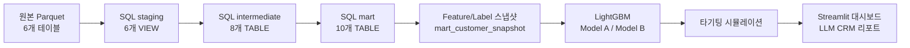
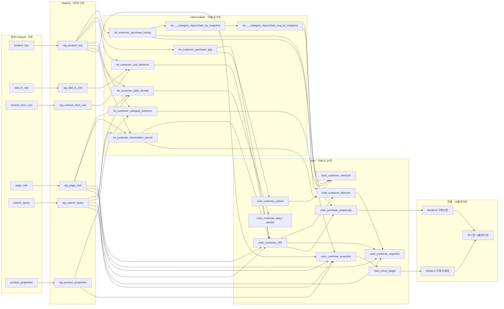

# 고객 라이프사이클 기반 CRM 타겟팅 전략 설계
### Customer Lifecycle-Based CRM Targeting Strategy

2.25억 건의 행동 로그로 고객 라이프사이클을 나누고, CRM 타겟팅 정책별 효율을 비교한 분석이다.

    


> **데이터 시점**: 2022-06-23 ~ 2022-12-08(6개월 스냅샷)이다. 최신 고객 행동이
> 아니라 2022년 하반기 특정 시점의 행동 패턴 분석이며, 실제 CRM 캠페인을
> 집행한 적은 없다. 과거 데이터로 대상 선정 효율을 검증한 방법론 시연이다.

## 한눈에 보기

| 문제 | 데이터 | 역할·기간 | 기술 |
|---|---|---|---|
| 고객마다 탐색·장바구니·구매 경로가 다른데 동일한 CRM 타기팅이 적절한가 | Synerise 이커머스 행동 로그(고객 2,230만 명, 이벤트 2.25억 건) | 개인 프로젝트, 2026년 8~9월 | DuckDB·SQL·LightGBM·Streamlit |

**핵심 결과**

- 구매 유도(전환) 타겟팅: 모델이 동일 Recall 기준 접촉 인원을 21.68~50.87%(접촉 5~30% 구간) 줄였다.
- 재활성화(비활성 위험) 타겟팅: 모델이 규칙보다 통계적으로 우수(AUC 0.754 vs 0.669)하지만 실무 절감 효과는 1% 내외라 단순 규칙 유지가 합리적이다.
- 장바구니 미구매 고객은 하나의 그룹이 아니라 보류형(79.38%)·빠른 이탈(72.0%, 약 16분)·고민 후 이탈(28.0%, 18.4일)로 나뉜다.
- 구매자의 28.46%는 탐색·장바구니 기록 없이 구매만 기록돼 있다 — 앱 딥링크 등 로깅 범위 밖 유입일 가능성이 있으나 데이터로 확정할 수는 없다.

**제안**: 구매 유도 타겟팅에는 모델 기반 접근을 단계적으로 도입하고, 재활성화 타겟팅은 운영 비용 대비 이득이 작아 단순 규칙을 유지한다.

## 목차

1. [문제 정의](#1-문제-정의)
2. [데이터](#2-데이터)
3. [분석 설계](#3-분석-설계)
4. [SQL 하이라이트](#4-sql-하이라이트)
5. [핵심 결과](#5-핵심-결과)
6. [제안](#6-제안)
7. [판단 기록](#7-판단-기록)
8. [한계와 다음 단계](#8-한계와-다음-단계)
9. [재현 방법](#9-재현-방법)
10. [저장소 구조](#10-저장소-구조)
11. [역할](#11-역할)
12. [라이선스](#라이선스)

---

## 1. 문제 정의

모든 고객에게 똑같은 CRM 메시지를 보내는 게 맞는지를 묻는 프로젝트다. 예전엔
샀지만 요즘 안 사는 고객과, 아직 안 샀지만 살 것 같은 고객은 다르다. 이 둘을
구분해 제한된 CRM 접촉 자원 안에서 누구를 먼저 챙길지 우선순위를 정하는
분석 시스템을 만들었다.

핵심 질문은 하나다.

> 단순 규칙(최근성 등)이나 무작위 타기팅보다, 구매 비활성 위험 고객과 향후
> 구매 고객을 더 효율적으로 선별할 수 있는가?

## 2. 데이터

- **데이터셋**: Synerise RecSys Challenge 2025 원본 데이터(실제 온라인 리테일
  서비스의 익명화 고객 행동 로그). 공식 출처:
  https://recsys.synerise.com/data-set
- **라이선스**: CC BY-NC 4.0(© 2025 Synerise SA). 원본 데이터는 라이선스상 이
  저장소에 포함되지 않는다. 확보 절차는
  [`reports/phase1_download_log.md`](reports/phase1_download_log.md) 참고.
- **테이블**: `product_buy`, `add_to_cart`, `remove_from_cart`, `page_visit`,
  `search_query`, `product_properties`
- **규모**: 고객 22,298,361명, 행동 이벤트 225,224,262건 중 구매 경험이 있는
  고유 고객은 909,210명이다. `product_properties`(상품 속성 참조 테이블)
  1,534,050행은 이벤트가 아니므로 집계에서 제외했다.
- 상품 페이지와 `sku`가 연결되지 않아(`page_visit.url`이 익명 숫자 ID)
  **상품 단위 분석은 구조적으로 불가능**하고, 이 프로젝트는 고객 단위 분석만
  다룬다.

## 3. 분석 설계

원래 던졌던 핵심 질문 15개를 검증 가능한 가설 6개로 재구성했다.

| 가설 | 지표 | 방법 |
|---|---|---|
| 고객 대부분은 탐색→장바구니→구매 단일 경로를 따른다 | 탐색·장바구니 기록 유무별 구매자 비율 | SQL 경로 분해(CASE 조합) |
| 첫 구매 이후 재구매는 예측 가능한 수준으로 누적된다 | 7/14/28일 재구매율 | 코호트 조인 + 우측 검열 플래그 |
| 고객은 구매 recency 기준으로 뚜렷한 라이프사이클 상태를 가진다 | recency 기반 8개 상태 분포 | 데이터 기반 임계값(구매 간격 중앙값·p90 배수) |
| 비활성 예측(Model A)에서 모델이 규칙보다 효율적이다 | AUC, Lift@10% | LightGBM vs 최근성 규칙 비교 |
| 구매성향 예측(Model B)에서 모델이 규칙보다 효율적이다 | AUC, Lift@10%, 동일 Recall 접촉 인원 절감률 | LightGBM vs 최근성 규칙 비교 |
| LLM이 SQL/모델 결과를 왜곡 없이 설명할 수 있다 | 금지 표현(매출 개선 등) 검출 여부 | Pydantic 스키마 검증 + 금지어 규칙 |

전체 파이프라인은 다음과 같다.



가설 검증 전체 기록은 [`docs/hypotheses.md`](docs/hypotheses.md), 상세 수치는
[`docs/analysis_details.md`](docs/analysis_details.md)에 있다.

## 4. SQL 하이라이트

데이터 계보는 원본 Parquet 6개 → staging VIEW 6개 → intermediate TABLE 8개 →
mart TABLE 10개 순서다. `mart_customer_snapshot`은 Model A용 feature/label
스냅샷이고, `mart_churn_target`은 여기서 파생된다. `mart_purchase_propensity`
(Model B)는 모집단 정의가 달라 동일한 설계 패턴을 쓰되 staging·intermediate
테이블에서 독립적으로 다시 계산한다.



아래 두 쿼리는 CTE와 윈도우 함수를 함께 써서 비즈니스 로직을 분명하게 표현한
사례다.

### 라이프사이클 상태 분류

**목적**: 구매 recency와 "복귀 고객" 여부를 윈도우 함수로 함께 판정해 전체
고객을 8개 라이프사이클 상태로 분류한다.

전체 파일: [`sql/marts/mart_customer_lifecycle.sql`](sql/marts/mart_customer_lifecycle.sql)

```sql
WITH last_gap AS (  -- 가장 최근 구매 occasion 직전 간격 (복귀 고객 판정용)
    SELECT client_id, days_since_prev_purchase_occasion AS gap_before_last_purchase
    FROM (
        SELECT client_id, days_since_prev_purchase_occasion,
               ROW_NUMBER() OVER (
                   PARTITION BY client_id ORDER BY purchase_occasion_seq DESC
               ) AS rn
        FROM int_customer_purchase_history
    )
    WHERE rn = 1
)
SELECT
    client_id,
    CASE
        WHEN is_buyer AND days_since_last_purchase <= 14 AND n_purchase_days = 1
            THEN '첫_관측_구매_고객'
        WHEN is_buyer AND days_since_last_purchase <= 14 AND n_purchase_days >= 2
             AND gap_before_last_purchase > 28
            THEN '복귀_고객'
        WHEN is_buyer AND days_since_last_purchase <= 14 AND n_purchase_days >= 2
            THEN '활성_구매_고객'
        WHEN is_buyer AND days_since_last_purchase BETWEEN 15 AND 28
            THEN '구매_감소_고객'
        WHEN is_buyer AND days_since_last_purchase BETWEEN 29 AND 60
            THEN '구매_비활성_위험_고객'
        WHEN is_buyer AND days_since_last_purchase > 60 THEN '비활성_고객'
        WHEN NOT is_buyer AND has_cart_activity THEN '장바구니_고객'
        WHEN NOT is_buyer AND (n_page_visit > 0 OR n_search_query > 0) THEN '탐색_고객'
        ELSE '기타'
    END AS lifecycle_stage
FROM base;
```

**결과 해석**: 임계값(14/28/60일)은 구매 간격 중앙값·p90의 배수로 데이터
기반 도출했고, 전체 22,298,361명이 미분류 없이 8개 상태로 정확히 나뉜다.

### 구매 occasion 순번·간격 계산

**목적**: 코호트 배정과 재구매율 계산의 공통 기반이다. 동일 결제 내 여러
상품이 같은 타임스탬프로 중복 기록되는 문제를 occasion 단위로 묶어, 구매
순번과 재구매 간격을 윈도우 함수로 계산한다.

전체 파일: [`sql/intermediate/int_customer_purchase_history.sql`](sql/intermediate/int_customer_purchase_history.sql)

```sql
WITH occasion AS (
    SELECT DISTINCT client_id, event_ts FROM stg_product_buy
),
occasion_seq AS (
    SELECT
        client_id,
        event_ts,
        ROW_NUMBER() OVER (PARTITION BY client_id ORDER BY event_ts) AS purchase_occasion_seq,
        date_diff(
            'day',
            LAG(event_ts) OVER (PARTITION BY client_id ORDER BY event_ts),
            event_ts
        ) AS days_since_prev_purchase_occasion
    FROM occasion
)
SELECT
    b.client_id, b.event_ts, b.sku,
    o.purchase_occasion_seq,
    o.days_since_prev_purchase_occasion,
    o.purchase_occasion_seq = 1 AS is_first_observed_purchase
FROM stg_product_buy b
JOIN occasion_seq o ON b.client_id = o.client_id AND b.event_ts = o.event_ts;
```

**결과 해석**: 동일 타임스탬프 재등장 비율이 63.72%에 달해, 원본 행 단위로
순번을 매기면 구매 간격이 0으로 왜곡된다. occasion 단위로 재계산해 이 문제를
구조적으로 막았고, 이 결과를 `mart_customer_cohort`·`mart_customer_retention`이
그대로 재사용한다.

## 5. 핵심 결과

**1) 구매 유도(전환) 타겟팅은 모델이 접촉 인원을 크게 줄인다.**
Model B(구매성향, LightGBM)는 AUC 0.865(규칙 기반 0.804), 상위 10% Recall
62.25%(규칙 55.54%, 무작위 9.96%)를 기록했다. 동일 Recall 기준 접촉 인원을
21.68~50.87%(접촉 5~30% 구간) 줄였다.


**2) 재활성화 타겟팅은 통계적 우위와 실무 효율이 갈린다.**
Model A(구매 비활성)는 AUC 0.754로 규칙 기반(0.669)보다 뚜렷이 우수하지만,
Lift@10%는 1.04 수준에 그친다. 라벨 기저율이 이미 90%+(다수 클래스)라 Lift가
구조적으로 오를 여지가 거의 없기 때문이다.


**3) 장바구니 미구매는 하나의 그룹이 아니라 최소 셋이다.**
담은 지 약 16분 만에 뺀 빠른 이탈(72.0%, 대안 상품 추천이 적합), 18.4일을
고민하다 뺀 고민 후 이탈(28.0%, 강한 프로모션이 정당화됨), 제거 이벤트 자체가
없는 보류형(79.38%, 가벼운 리마인더면 충분)으로 나뉜다.


**4) 구매자의 28.46%는 탐색 기록 없는 구매다.**
`page_visit`/`search_query` 없이 구매만 기록된 고객이 258,808명이다(대표
그림 참고, 맨 위). 앱 딥링크나 재구매 단축 경로 등 로깅 범위 밖 유입일
가능성이 있으나 데이터로 확정할 수 없다. "탐색량이 많을수록 구매 가능성이
높다"는 결론은 탐색 기록이 있는 구매자 집단 안에서만 유효하다.

상세: [`reports/phase6_modeling_results.md`](reports/phase6_modeling_results.md),
[`docs/analysis_details.md`](docs/analysis_details.md)

## 6. 제안

> 아래는 전부 "과거 데이터 기준 대상 선정 효율"만 나타낸다. 실제 캠페인을
> 집행하지 않았으므로 이탈률 개선·매출 증가 등 실제 비즈니스 성과를
> 주장하지 않는다.

| 영역 | 제안 | 근거 | 비고 |
|---|---|---|---|
| 구매 유도(전환) 타겟팅 | 모델 기반 접근 단계적 도입 | 동일 Recall 기준 접촉 인원 21.68~50.87% 절감 | 과접촉 위험이 낮은 세그먼트부터 적용 |
| 재활성화(비활성 위험) 타겟팅 | 단순 최근성 규칙 유지, 모델 도입 보류 | Lift 1.04 개선이 재현 파이프라인 운영 비용을 상회하기 어려움 | 운영 비용과 비교해 재검토 필요 |
| 장바구니 이탈형(20.62%) | 대안 상품 추천 A/B 테스트 | 이미 제거(거부) 신호가 확인된 그룹 | Primary KPI: 7일 체크아웃 완료율 |
| 장바구니 보류형(79.38%) | 가벼운 리마인더만 적용 | 제거 이벤트가 없어 로깅 누락·시간 부족이 아닌 미결정 상태로 확인 | 과도한 프로모션은 지양 |

## 7. 판단 기록

### 퍼널 가정: 단일 경로 → 경로 분해

**상황**: 고객 대부분이 탐색→장바구니→구매 단일 경로를 따를 것이라 가정하고
분석을 설계했다.
**선택**: 퍼널을 4갈래 경로로 분해해 재분석했다.
**이유**: 구매자 909,210명 중 표준 경로 완주 비율은 63.54%뿐이었고,
28.46%는 탐색 기록 자체가 없었다.
**결과**: "탐색량이 많을수록 구매 가능성이 높다"는 결론을 탐색 기록이 있는
구매자 집단 안으로 한정했다.

### Lift와 AUC 중 어느 지표로 모델을 평가할 것인가

**상황**: Model A의 Lift@10%가 1.0~1.07에 그쳐, 라벨을 희소하게(60일 비활성)
만들면 Lift가 개선될 것이라 가정했다.
**선택**: 라벨 윈도우를 14일에서 60일로 늘려 직접 통제 실험을 했다.
**이유**: Lift@10%는 예상대로 올랐지만(1.038→1.105) AUC는 오히려
하락했다(0.7433→0.7109) — Lift가 라벨 기저율에 크게 좌우된다는 뜻이다.
**결과**: Model A는 Lift가 아니라 AUC로 평가하기로 기준을 바꿨다.

### 우측 검열 고객 처리 방침

**상황**: 관측 종료 14일 이내 마지막 구매를 한 고객(15.18%, 138,041명)은
그 이후 비활성 여부를 데이터로 알 수 없는 구조적 문제가 있었다.
**선택**: 검열 고객을 개별 제외하거나 생존분석을 쓰는 대신, `snapshot_date`를
관측 종료일에서 라벨 윈도우만큼 이전으로 제한하는 설계로 검열을 원천
차단했다.
**이유**: 기존 Feature/Label Window 구조를 그대로 재사용해 추가 복잡도 없이
해결할 수 있었고, 생존분석은 이 프로젝트 스코프 대비 과설계로 판단했다.
**결과**: 고객 단위 검열 판정 로직 없이, `snapshot_date + 라벨기간 <= 관측
범위`를 검증하는 pytest로 안전장치를 확보했다.

### 장바구니 세그먼트 분리(이탈형/보류형)

**상황**: 장바구니_고객 세그먼트의 79.38%가 제거 이벤트 자체가 없다는 사실을
발견했다.
**선택**: 로깅 누락·시간 부족 가설을 검증 후 기각하고, 세그먼트를
장바구니_이탈형과 장바구니_보류형 2개로 분리했다(8개→9개).
**이유**: 능동적 거부(이탈형)와 미결정(보류형)은 실제 CRM 대응이 달라야
한다는 근거를 확보했다.
**결과**: 이탈형에는 대안 상품 추천, 보류형에는 가벼운 리마인더로 액션을
분리해 제안했다.

더 많은 판단 기록은 [`docs/methodology.md`](docs/methodology.md),
[`docs/decisions_pending_review.md`](docs/decisions_pending_review.md)에 시간순으로
남아 있다.

## 8. 한계와 다음 단계

**구현한 것**: SQL 기반 고객행동 데이터마트, Funnel/Retention/Lifecycle 분석,
9개 CRM 세그먼트, 구매 비활성/구매성향 예측 모델(LightGBM), 타기팅 정책
시뮬레이션, Streamlit 대시보드(7페이지), A/B 테스트 배정·검증 프레임워크
(`src/experiments/`).

**아직 검증되지 않은 것**: 실제 CRM 메시지 발송, 실제 Treatment-Control 성과
측정, Incremental conversion/revenue, 실제 서비스 환경에서의 장기 효과.

**핵심 한계 4가지**(전체: [`docs/limitations.md`](docs/limitations.md)):

1. **데이터 최신성**: 2022년 6~12월 스냅샷이라 실시간 고객 행동을 반영하지
   않는다.
2. **6개월 고정 관측 창의 구조적 제약**: 관측 시작 시점에 활동 중이던 고객의
   진짜 첫 구매를 알 수 없고, 관측 종료 근처 고객의 장기 리텐션은 판단할 수
   없다(우측 검열).
3. **category 컬럼의 신뢰도**: 익명 정수 ID인 `category`가 상품명 임베딩
   기준 유사성과 거의 무관하다(NMI 0.1258). "카테고리 기반" 추천은 이 한계
   위에 있다.
4. **상품 단위 분석 불가**: `page_visit.url`과 `sku`를 연결할 키가 없어
   상품 단위 분석은 할 수 없다.

**다음 단계**: Model B가 찾은 "구매확률이 높은 고객"(Propensity)과 "CRM을
보내야 구매가 발생하는 고객"(Incrementality)은 다른 개념이다. 점수 구간별로
Treatment/Control을 무작위 배정하는 실험으로 이 둘의 차이를 검증한 뒤, 필요하면
Uplift Modeling으로 확장하는 방향을 제안한다. 상세: [`docs/analysis_details.md`](docs/analysis_details.md)

## 9. 재현 방법

```bash
python3 -m venv .venv && source .venv/bin/activate
pip install -r requirements.txt

# 원본 데이터를 data/raw/synerise_dataset/에 위치시킨 후
python3 scripts/build_database.py
python3 scripts/train_model_a.py && python3 scripts/train_model_b.py
python3 scripts/build_targeting_simulation.py
python3 scripts/build_dashboard_data.py
streamlit run app/Home.py

pytest tests/ -q   # 데이터 품질·모델·파이프라인 테스트 전체 실행
```

Python 3.12, DuckDB, LightGBM 기준으로 작성했다. 대시보드 배포 절차는
[`docs/deployment.md`](docs/deployment.md) 참고.

## 10. 저장소 구조

```
.
├── app/            Streamlit 대시보드(Home+7개 페이지)
├── config/         경로 설정(YAML)
├── docs/           방법론·ERD·데이터 사전·한계·가설 검증 기록
├── reports/        Phase별 분석 리포트·그림·표
├── scripts/        빌드·검증·모델 학습·시뮬레이션 실행 스크립트
├── sql/            staging/intermediate/mart 데이터 계보(DuckDB)
├── src/            분석·모델링·실험·LLM·대시보드 공통 모듈
├── tests/          데이터 품질·모델·파이프라인 pytest
├── requirements.txt
└── LICENSE
```

## 11. 역할

개인 프로젝트다. 기획부터 SQL 데이터마트 설계, 모델링, 타기팅 시뮬레이션,
Streamlit 대시보드, LLM CRM 리포트까지 전체를 혼자 맡았다. 기간은 2026년
8~9월이다.

## 라이선스

코드는 [MIT License](LICENSE)를 따른다. 데이터는 원 출처(Synerise SA,
CC BY-NC 4.0)의 라이선스를 따르며 이 저장소에는 포함하지 않는다. 자세한 내용은
"2. 데이터" 절 참고.
