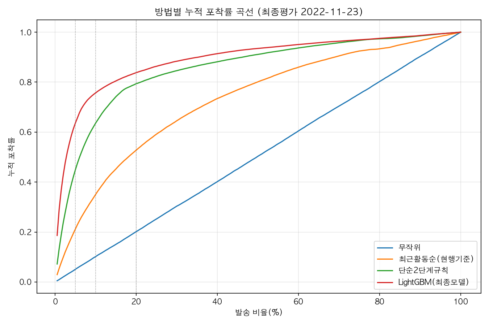
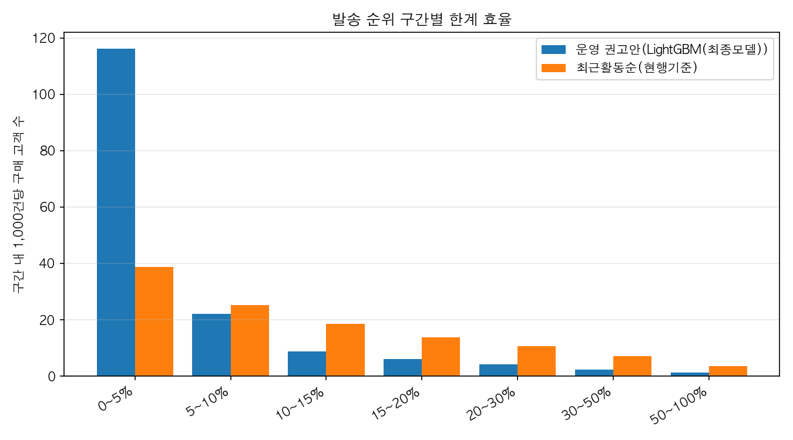
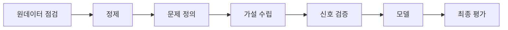

# 구매 신호 기반 CRM 발송 대상 선정 기준 설계
CRM Targeting by Purchase Signals

> 발송량을 상위 10%로 제한할 때, 최근 활동 순으로 고르면 구매 고객의 35%를 잡는다. "장바구니·구매·검색 행동이 있는 고객 우선" 단순 규칙만으로 64%, 행동 신호 점수로는 76%를 잡아, 발송 1만 건당 구매 고객이 320명에서 692명으로 늘어난다. 비교 기준이 잡는 구매 고객 수를 발송량의 1.4%만으로 잡을 수 있어 발송량을 86% 줄일 수 있다.



## 한눈에 보기

| 항목 | 내용 |
|---|---|
| 문제 | 한정된 CRM 발송량을 누구에게 먼저 쓸지 근거가 없다 |
| 데이터 | 실제 이커머스 행동 로그(Synerise RecSys Challenge 2025), 2022.06~12, 고객 약 2,230만 명 |
| 역할·기간 | 개인 프로젝트 · 최초 분석 2026.08–09, 전 과정 재설계 2026.10 |
| 기술 | SQL(DuckDB), Python, LightGBM, 로지스틱 회귀 |

## 1. 문제 정의

| 구분 | 내용 |
|---|---|
| 현상 | 168일간 방문 고객 2,230만 명 중 구매 고객은 91만 명(4.1%)이고, 84%는 방문만 하고 다른 행동이 없다. |
| 문제 | CRM 메시지는 보낼 수 있는 양이 한정돼 있다. 전체 발송은 비용과 수신 거부를 늘리고, 단순 기준(최근 방문 등)으로 보내면 구매 의사가 없는 고객에게 낭비된다. 누구에게 먼저 보낼지 근거가 없다. |
| 목표 | 고객의 행동 신호로 가까운 시일 내 구매 가능성을 점수화해, 같은 발송량으로 더 많은 구매 고객에게 도달하는(또는 같은 도달 수를 더 적은 발송으로 달성하는) 발송 대상 선정 기준을 만든다. |

## 2. 결과

최종평가 기준일(2022-11-23, 모집단 614만 명)에서 네 방법을 같은 조건으로 비교했다. 발송 비율은 전체 모집단 중 메시지를 보낼 고객의 비율이고, 포착률은 실제로 구매한 고객 중 그 발송 대상에 포함된 비율이다.

| 방법 | 5% 포착률 | 10% 포착률 | 20% 포착률 | 10% 1만 건당 구매 고객 |
|---|---|---|---|---|
| 무작위 | 5.0% | 10.1% | 20.0% | 92명 |
| 최근 활동 순(비교 기준) | 21.2% | 35.1% | 52.8% | 320명 |
| 단순 2단계 규칙 | 44.9% | 63.6% | 79.4% | 581명 |
| 행동 신호 모델(LightGBM) | 63.6% | 75.7% | 83.8% | 692명 |

무작위의 포착률이 발송 비율과 거의 정확히 같다(5.0%/10.1%/20.0%). 평가 절차 자체가 올바르다는 검증이다.

가설 7(H7): 모델이 비교 기준보다 같은 발송량에서 더 많은 구매 고객을 포착하는가. 발송 5·10·20% 모두에서 모델이 더 많이 포착했고, 고객을 무작위로 복원추출해 같은 계산을 1,000번 반복하는 부트스트랩으로 구한 95% 신뢰구간 하한이 세 발송량 모두 0보다 컸다(최소 +17,134명). 단순 2단계 규칙과 비교해도 모든 발송량에서 유의하게 더 많이 포착했다. 채택.

비교 기준이 상위 10%(614,467건 발송)로 포착하는 구매 고객 19,675명을, 모델은 상위 1.38%(84,859건) 발송만으로 같은 수를 포착한다. 발송량을 86% 줄일 수 있다는 계산은 이 두 발송량의 차이에서 나온다.

가설 8(H8): 적정 발송량이 존재하는가. 발송 순위를 구간으로 나눠 구간마다 1,000건당 구매 고객 수를 보면, 상위 0~5% 구간은 116.2명인데 15~20% 구간은 5.9명으로 20분의 1까지 떨어진다(0~5% 구간의 절반 이하면 채택으로 미리 정했다). 채택. 상위 5%까지가 가장 효율적이고, 그 뒤로는 구간마다 효율이 꾸준히 낮아진다.



### 신호의 구조: "있다/없다"와 "얼마나"

구매 신호 변수 6개 중 5개(H1·H2·H3·H4·H5)가 채택됐지만, 그 예측력의 대부분은 "행동이 있었는지 없었는지"에서 나온다. 결측·0 구간을 빼고 "행동이 있는 고객들 사이에서"만 다시 계산한 IV(정보가치, 변수가 구매 여부를 얼마나 잘 가르는지 나타내는 지표)를 보면 이 구조가 드러난다.

| 가설 | 핵심 변수 | 배수(95% CI) | 전체 IV | "있다/없다" 제외 IV | 판정 |
|---|---|---|---|---|---|
| H1 최근 활동 | 마지막 활동 경과일 | 9.71배 | 0.504 | 0.504(해당 없음, 모든 고객이 값을 가짐) | 채택 |
| H2 보류 상품 | 담아두고 안 산 상품 수 | 5.29배 | 0.410 | 0.318 | 채택 |
| H3 과거 구매 | 신호 기간 구매 건수 | 26.30배 | 1.744 | 0.255 | 채택 |
| H4 실제 검색 | 실제 검색 횟수 | 6.02배 | 0.427 | 0.473 | 채택 |
| H5 활동 증가율 | 최근 14일 대비 활동 증가율 | 6.96배 | 0.692 | 0.092 | 채택 |
| H6 장바구니 제거 | 제거 비율 | 0.32배(0.29~0.35, 예상과 반대) | 1.384 | 0.064 | 기각 |

H3·H5·H6은 "있다/없다" 구간을 빼면 IV가 1.7→0.3, 0.7→0.1 수준으로 급격히 줄어든다. 반면 H1은 모든 고객이 활동 이력을 가져 이 구분 자체가 적용되지 않고, 10개 구간 전체에서 포착률이 매끄럽게 줄어든다. "얼마나 최근인지"의 정도 정보가 가장 풍부한 변수다. 자세한 수치와 계산 방식은 [`v2/docs/09_checks.md`](v2/docs/09_checks.md)에 있다.

### 실무 시사점: 장바구니에서 뺀 고객은 제외 대상이 아니다

H6은 "제거한 고객일수록 구매율이 낮다"는 예상과 반대로, 제거 비율이 높은 고객의 구매율이 오히려 3배 이상 높게 나왔다. 담기 건수 구간(1건, 2~3건, 4~9건, 10건 이상)을 나눠 같은 장바구니 사용량 안에서 비교해도 이 관계는 유지된다. 장바구니를 많이 쓰는 고객이라서 생긴 착시와는 다르다. 제거 이벤트의 34%가 24시간 안에 그 고객의 구매로 이어졌다. "결제 전 정리"인지 "여러 후보를 담아두고 고르는 과정"인지는 이 데이터로는 구분되지 않았다. 다만 어느 쪽이든 실무적으로는 **장바구니에서 상품을 뺀 고객을 리마인드 발송 제외 대상이 아니라 우선 대상으로 다뤄야 한다**는 결론은 같다. 근거는 [`v2/docs/10_prechecks.md`](v2/docs/10_prechecks.md)의 P3에 있다.

## 3. 한계와 다음 단계

- 최종평가 구매 고객의 24%(13,229명)는 60일 신호 기간에 방문만 하던 고객이었다. 이 고객군에 대한 모델의 상위10% 포착률(15.7%)은 비교 기준(21.3%)보다 낮다. 전체 성능이 좋은 모델도 활동 흔적이 적은 고객에게는 상대적으로 약하다.
- 이 결과는 "곧 살 고객을 고르는 효율"이지 메시지를 보냈을 때의 효과가 아니다. 실제 발송 기록이 데이터에 없어, 메시지가 구매를 늘렸는지는 이번 분석으로 측정할 수 없다.
- 상품 가격이 0~99 구간화 지수라 실제 금액이 없어 매출 기준 분석은 할 수 없었다. 관측 기간(168일) 양끝의 경계 때문에 기간 시작 전부터 활동했을 고객과 종료 후 행동했을 고객이 구분 없이 잘려 보이는 좌·우측 검열 문제가 있어, 생애 전체 이력이 필요한 분석에는 적용하지 않았다.
- 다음 단계로 점수 구간별 발송군과 미발송군을 무작위로 나눠 실제 효과를 측정하는 실험을 설계한다. 1차 지표(Primary KPI)는 14일 내 구매율 차이로 잡는다.

## 4. 판단 기록

상황이 생겼을 때 무엇을 선택했고 왜 그랬는지, 그리고 그 선택이 어떤 결과로 이어졌는지를 순서대로 남긴다.

1. 구매 기록 16%가 완전히 똑같이 중복됨. 수량(같은 상품을 여러 개 사서), 시간 반올림, 기록 처리 오류 세 가지 설명을 각각 검증했다. 수량이라면 안 맞는 정황(장바구니 담기 횟수와 중복 횟수가 안 맞음)이 나왔고, 반올림이라면 5초 단위로 뭉친 시각과 아닌 시각의 중복률이 달라야 하는데 차이가 없었다. 대신 월초에 낮았다가 월말로 갈수록 치솟는 패턴이 6개월 내내 반복돼, 기록 처리 과정의 월 단위 중복으로 판단하고 완전 중복 행을 하나로 합쳤다.
2. 검색어의 21%가 같은 값. 행사 키워드, 광고 링크, 빈 검색 세 해석을 유사 코드 존재 여부·전체 추이 모양·반복 사용 패턴·등장 시작 시각으로 검증했다. 행사 키워드라면 설명되지 않는 특징(2022-07-28 특정 시각에 갑자기 등장, 같은 날 2회 이상 반복한 경우가 63%, 한 고객이 전체 기간 최대 1,445회 반복)이 나와 기각했고, 빈 검색이 가장 유력하다고 판단했다. 다만 어느 해석이든 안전하도록 이 값을 실제 검색 횟수에서는 빼고 별도 표시 변수로만 남겼다.
3. 봇 판정 기준을 수정함. 처음 정한 후보 정의(여러 테이블에서 동시에 활동량이 극단적인 고객)가 한 테이블(방문)에서만 극단적인 봇을 놓친다는 것을 확인하고, 전체 고객 대상 속도 기준(1분에 60건 이상)을 별도로 추가해 197명을 찾았다. 이 과정에서 기존 후보군(1,183명) 중 원본 기준으로는 속도 신호를 만족했을 10명 중 7명이 완전 중복 제거만으로 더 이상 만족하지 않게 되는 것도 확인했다. 정제 순서가 판정에 실제로 영향을 줬다.
4. 너무 강한 IV를 의심함. H3(과거 구매)의 IV가 1.6으로 지나치게 높아, 먼저 결과 기간과 신호 기간이 코드에서 실제로 겹치지 않는지 줄 단위로 확인했다(겹침 없음). 그다음 "있다/없다"와 "정도"의 신호를 분리해보니, 강한 IV 대부분이 "행동이 있는지"에서 나온다는 것을 확인했다.
5. 모델이 꼭 필요하지 않을 수 있다고 보고 비교 대상을 추가함. "행동이 있는 고객 우선, 그 안에서 최근 활동 순"이라는 변수 2개짜리 단순 규칙을 비교 대상에 넣고, "모델이 이 규칙보다 상위10% 포착률에서 1%p 이상 낫지 않으면 단순 규칙을 운영 권고안으로 한다"는 기준을 결과를 보기 전에 고정했다. 결과는 모델이 12%p 이상 앞서 모델을 권고했지만, 단순 규칙도 이미 비교 기준을 크게 앞서는 수준이었다.
6. 결과가 지나치게 좋아 비교 기준이 약했는지 의심함. 비교 기준("최근 활동 순")이 혹시 날짜 단위로 뭉뚱그려 비교가 유리했던 것은 아닌지 코드를 확인했다. 이미 초 단위로 정렬하고 있었고(상위10% 경계 동률 9명뿐), 시각 기준으로 다시 정렬해도 결과는 완전히 같았다.
7. 코드 재검토 중 장바구니 보류 판정이 같은 시각의 담기·구매를 설명과 반대로 처리하는 것을 발견해 수정했다(영향 고객 0.02%). 같은 과정에서 표본 추출이 실행마다 달라지는 문제를 찾아 정렬을 고정했고, 전체를 두 번 실행해 결과가 동일함을 확인한 뒤 수치를 갱신했다. 가설 판정, 모델 선택, 기준선 순위는 모두 그대로였다.

## 5. 데이터

- 출처: [Synerise RecSys Challenge 2025](https://recsys.synerise.com/data-set) 공식 공개 데이터(© 2025 Synerise SA)
- 라이선스: CC BY-NC 4.0. 원본 데이터는 이 저장소에 포함하지 않는다. 받는 방법은 [`v2/docs/01_data_audit.md`](v2/docs/01_data_audit.md) 참고
- 테이블 6개: `product_buy`(구매), `add_to_cart`(담기), `remove_from_cart`(빼기), `page_visit`(방문), `search_query`(검색), `product_properties`(상품 속성), 한 행이 이벤트 1건이다
- 관측 기간: 2022-06-23 ~ 2022-12-08(168일), 고객 약 2,230만 명
- 알 수 없는 정보: 실제 결제 금액(가격은 0~99 구간화 지수), 메시지 발송 기록, 고객 인구통계, 주문 번호(한 행이 상품 1개 단위). 자세한 내용은 [`v2/docs/02_variable_catalog.md`](v2/docs/02_variable_catalog.md) 참고
- 정제 결과: 완전 중복 제거(product_buy 16.43%, page_visit 10.38% 등), 검색 기본값 분리(실제 검색 외 22.3%는 기술적 요인으로 추정되는 값으로 별도 표시), 속도 기준 봇 197명 제외. 자세한 근거는 [`v2/docs/06_cleaning_decisions.md`](v2/docs/06_cleaning_decisions.md), [`v2/docs/10_prechecks.md`](v2/docs/10_prechecks.md) 참고

## 6. 분석 과정



가설은 결과를 보기 전에 세우고, 결과를 본 뒤에는 기준값을 바꾸지 않았다. 각 단계의 산출물은 [`v2/docs/`](v2/docs/)에 번호순으로 있다.

스냅샷 설계(한 행 = 고객 1명 × 기준일 1개, 행동 신호 60일·결과 확인 14일):

| 구분 | 기준일 | 결과 데이터 사용 시점 |
|---|---|---|
| 학습 | 08-22, 09-05, 09-19, 10-03, 10-17(5개) | 가설 검증·모델 학습에 사용 |
| 검증 | 11-07(모집단 5,665,601명) | 모델·설정 선택에만 사용 |
| 최종평가 | 11-23(모집단 6,144,670명) | 모든 선택이 끝난 뒤 한 번만 개봉 |

학습 마지막 기준일(10-17)의 결과 확인 기간은 10-31에 끝나 검증 기준일(11-07) 이전이고, 검증의 결과 확인 기간도 11-21에 끝나 최종평가(11-23) 이전이다. 미래 정보가 앞 단계에 섞이지 않는다.

검증 결과(상위10% 포착률)와 선택 규칙 적용:

| 방법 | 상위10% 포착률 |
|---|---|
| 무작위 | 9.9% |
| 최근 활동 순 | 31.3% |
| 단순 2단계 규칙 | 62.1% |
| 로지스틱 회귀 | 72.9% |
| LightGBM | 74.2% |

선택 규칙 세 가지를 결과를 보기 전에 고정했다. ① LightGBM이 로지스틱보다 1%p 이상 나으면 LightGBM 선택 → LightGBM이 1.22%p 앞서 선택됨. ② 검색 기본값 표시를 빼서 포착률이 0.5%p 이상 떨어지면 유지 → 1.42%p 떨어져 유지. ③ 모델이 단순 규칙보다 1%p 이상 나으면 운영 권고안을 모델로 함 → 12.08%p 앞서 모델로 결정.

민감도 확인(최종평가, 상위10% 포착률 변화): 속도 봇 제외를 적용하지 않으면 +0.003%p, 결과 기간에서 이상치가 의심되는 2022-12-04 하루를 빼면 +0.163%p로 둘 다 영향이 거의 없었다. 검색 기본값 표시 처리를 반대로 하면(유지→제거) −2.131%p로, 검증 단계에서 관찰한 하락폭(−1.42%p)과 방향·크기가 비슷해 선택 규칙이 최종평가에서도 일관됨을 확인했다.

## 7. SQL 하이라이트

**보류 중인 장바구니 상품 계산.** sku별 마지막 이벤트가 담기(add)인 것만 센다. 동시 타임스탬프에서는 구매·제거를 담기보다 우선 처리해 "보류 아님" 쪽으로 보수적으로 판단한다.

```sql
WITH ev AS (
    SELECT client_id, sku, timestamp, 'add' AS kind
      FROM clean_add_to_cart WHERE timestamp >= :w60_start AND timestamp < :w60_end
    UNION ALL
    SELECT client_id, sku, timestamp, 'remove' AS kind
      FROM clean_remove_from_cart WHERE timestamp >= :w60_start AND timestamp < :w60_end
    UNION ALL
    SELECT client_id, sku, timestamp, 'buy' AS kind
      FROM clean_product_buy WHERE timestamp >= :w60_start AND timestamp < :w60_end
),
ranked AS (
    SELECT *, row_number() OVER (
        PARTITION BY client_id, sku
        ORDER BY timestamp DESC,
                 CASE kind WHEN 'buy' THEN 1 WHEN 'remove' THEN 2 ELSE 3 END
    ) AS rn FROM ev
)
SELECT client_id, sku, timestamp AS add_ts
FROM ranked WHERE rn = 1 AND kind = 'add'
```

같은 고객·같은 상품의 가장 최근 이벤트만 남기고, 그게 담기였던 경우만 "아직 사지도 빼지도 않은 상품"으로 센다.

**정제 계층: 완전 중복 제거 + 검색 기본값 분리**

```sql
-- 완전 중복 제거(5개 이벤트 테이블 반복)
CREATE OR REPLACE TABLE clean_product_buy AS
SELECT DISTINCT * FROM read_parquet('data/raw/product_buy.parquet');

-- 검색 기본값(기술적 요인으로 추정되는 값) 분리
CREATE OR REPLACE VIEW clean_search_query_real AS
SELECT * FROM clean_search_query WHERE query <> :TOP_VALUE;

CREATE OR REPLACE VIEW clean_search_query_default AS
SELECT * FROM clean_search_query WHERE query = :TOP_VALUE;
```

모든 컬럼이 같은 행을 `SELECT DISTINCT`로 한 번에 합치고, 검색어 중 기술적 요인으로 추정되는 값만 뷰로 분리해 이후 모든 분석이 이 정제 계층만 쓰게 했다.

## 8. 재현 방법

```bash
# Python 3.13 기준
pip install -r requirements.txt

# 원본 데이터는 공식 사이트에서 받는다(CC BY-NC 4.0, 저장소에는 포함하지 않음)
bash v2/scripts/01_download_and_verify.sh

# 이후 스크립트를 번호 순서대로 실행
python3 v2/scripts/02_data_audit.py
python3 v2/scripts/03_variable_catalog.py
# ... v2/scripts/ 안의 02~16번을 번호 순서대로 실행
```

각 스크립트의 입력·출력과 산출물은 [`v2/docs/`](v2/docs/)의 같은 번호 문서에 설명돼 있다.

실행 조건: DuckDB `threads=1`, `seed=42`로 고정했다. 이 조건에서 10~15번 스크립트 전체를 두 번 실행해 모든 산출물(JSON·CSV)이 완전히 동일함을 확인했다.

## 9. 저장소 구조

```
.
├── README.md              # 이 문서
├── v2/                     # 재분석 전체(원데이터 점검부터 최종평가까지)
│   ├── scripts/            # 번호 순서대로 실행하는 분석 스크립트
│   ├── docs/                # 단계별 문서·결과 JSON·그림
│   └── verification/        # 대조용 집계 CSV(고객 단위 아님)
├── archive/v1/             # 이전 버전(보관용, 유지보수 안 함)
├── docs/internal/           # 내부 작업 지침 문서
├── requirements.txt         # v2 실행에 필요한 패키지
└── LICENSE                  # 코드는 MIT, 데이터는 별도 라이선스
```

## 10. 이전 버전(v1)

2026년 8~9월 첫 분석은 결과를 먼저 보고 가설을 정리했고 데이터 정제 기준도 달랐다. 이 문제를 2026년 10월에 원데이터 점검부터 다시 설계한 것이 이 저장소의 현재 버전이다. v1 코드와 산출물은 [`archive/v1/`](archive/v1/)에 그대로 보관돼 있다.

## 데이터 이용 조건과 라이선스

이 저장소의 코드(SQL, Python, 문서)는 MIT 라이선스를 따른다. 분석에 사용한 원본 데이터셋은 Synerise RecSys Challenge 2025(© 2025 Synerise SA)이며 CC BY-NC 4.0 라이선스로 별도 제공된다. 원본 데이터는 라이선스 조건에 따라 이 저장소에 재배포하지 않으며, 받는 방법은 [`v2/docs/01_data_audit.md`](v2/docs/01_data_audit.md)에 있다. 자세한 조건은 [`LICENSE`](LICENSE)를 참고한다.
